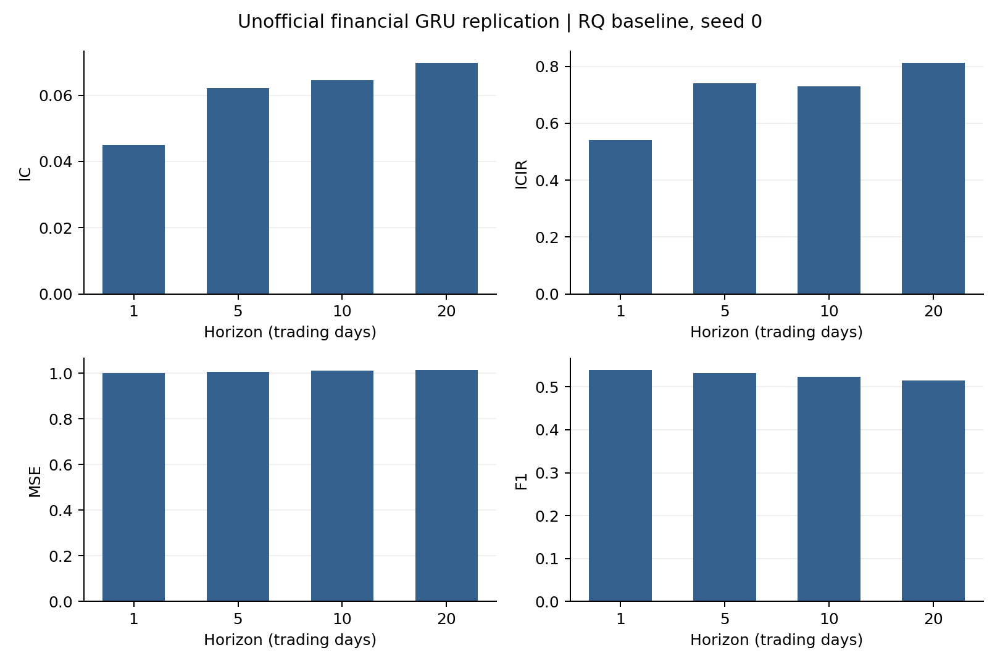

# GRU-Replication

**Unofficial, independent replication — NOT official code from the authors of either paper.**

[English](README.md) | [简体中文](README.zh-CN.md)

This repository publishes the completed **RQData financial GRU baseline, seed 0**, from the local run `rq_gru_seed0_20261007`. It is a replication of the **stock-return prediction baseline described in FactorGCL**, not the machine-translation experiments of the original GRU paper. Only this experiment is included; there is no seed-42 result in this release.

## Papers and attribution

**GRU source paper:** *Learning Phrase Representations using RNN Encoder–Decoder for Statistical Machine Translation* (EMNLP 2014, pp. 1724–1734).  
Authors: **Kyunghyun Cho, Bart van Merriënboer, Caglar Gulcehre, Dzmitry Bahdanau, Fethi Bougares, Holger Schwenk, Yoshua Bengio**.

- [ACL Anthology](https://aclanthology.org/D14-1179/) · [DOI](https://doi.org/10.3115/v1/D14-1179) · [arXiv](https://arxiv.org/abs/1406.1078)
- [paper.pdf](paper.pdf): the locally retained arXiv v3 version, 15 pages including appendices.

**Financial baseline context:** *FactorGCL: A Hypergraph-Based Factor Model with Temporal Residual Contrastive Learning for Stock Returns Prediction*, **Yitong Duan, Weiran Wang, Jian Li**, Tsinghua University, AAAI 2025, **39(1), 173–181**.

- [Official publication](https://ojs.aaai.org/index.php/AAAI/article/view/31993) · [DOI](https://doi.org/10.1609/aaai.v39i1.31993)
- [FactorGCL paper](references/FactorGCL-paper.pdf) · [FactorGCL appendix](references/FactorGCL-appendix.pdf)

Research credit belongs to the original authors. This independently implemented repository is maintained by [adrianelo0107](https://github.com/adrianelo0107), without affiliation with or endorsement by the authors, their institutions, ACL, or AAAI. No external unofficial code directory is included.

## Archived experiment and results

The model is a standard PyTorch **2-layer, 32-unit, unidirectional GRU**, followed by one shared four-output linear head. It uses the last hidden state, zero initialization per stock/window, bias enabled, dropout zero, and **no BatchNorm, factor/graph module, projection head, contrastive loss, or future-feature branch**. It has **10,308 trainable parameters**. The loss is the mean squared error over valid stock/horizon labels.

The test period is January 2020–June 2023: **846 signal days, 42 months, 3,384 date/horizon keys**. Original full-graph predictions contained 14,620,736 stock/date/horizon rows; those files contain actual labels and returns and are excluded.

| Horizon (trading days) | IC | ICIR | MSE | F1 |
|---|---:|---:|---:|---:|
| 1 | 0.045087 | 0.540233 | 1.000630 | 0.539254 |
| 5 | 0.062201 | 0.739637 | 1.005623 | 0.531890 |
| 10 | 0.064562 | 0.729079 | 1.011559 | 0.524230 |
| 20 | 0.069904 | 0.812965 | 1.013363 | 0.515359 |



[Complete training/validation histories](results/rq_gru_seed0/figures/training_history.png) · [42-month IC](results/rq_gru_seed0/figures/monthly_ic.png)

IC is mean daily cross-sectional Pearson correlation on valid labels. ICIR divides that mean by the population standard deviation of daily IC (`ddof=0`), without annualization. MSE averages daily MSE against cross-sectionally standardized labels; pooled MSE is retained separately. F1 pools strict positive/negative sign counts for predictions and **standardized labels**, rather than classifying positive raw returns; zero signs are tracked separately. Combined metrics are recomputed from concatenated daily records, not by averaging fold-level ICIR/F1. Monthly metrics are descriptive test-period evaluations. A single seed does not establish robustness or a stable ranking against FactorGCL.

## Training protocol and reproduction choices

| Fold | Train | Validation | Test | Best epoch | Stop epoch | Best four-horizon validation mean IC |
|---|---|---|---|---:|---:|---:|
| 1 | 2014–2018 | 2019 | 2020–2021 | 37 | 57 | 0.084779673 |
| 2 | 2016–2020 | 2021 | Jan 2022–Jun 2023 | 31 | 51 | 0.057788898 |

- Each fold is initialized from seed **0**, trains from scratch, and independently fits its training scaler. No pretrained model or previously fitted scaler is reused.
- Inputs: 60 market days × six features in the order `high,open,low,close,vwap,volume`. Each price is divided by the window-end close; volume by its valid-window mean.
- At most 20% history missingness; normalize, clip and fill missing inputs with zero. Invalid targets are masked. Input clipping uses training-only 0.1%/99.9% quantiles, with a seed-controlled priority reservoir of at most 200,000 samples per feature.
- Label: `VWAP[t+h+1] / VWAP[t+1] − 1`, for `h=1,5,10,20`, then cross-sectional standardization over valid stocks (`ddof=0`). Returns and standardized labels remain unclipped.
- One full date cross-section per optimization step; dates shuffled. Adam: learning rate 0.001, betas 0.9/0.999, epsilon 1e-8, no weight decay. Training and validation ends are purged by 21 trading days to keep their label endpoints within each partition.
- Maximum 100 epochs. Validate every epoch; strictly improve the arithmetic mean of four validation ICs (`min_delta=0`); stop after 20 consecutive non-improvements; test the best checkpoint. FactorGCL's appendix says “early stopping set to 20 steps”; this monitoring criterion and its epoch-based interpretation are implementation choices.

**Architecture disclosure.** FactorGCL describes its financial baseline as GRU plus a linear predictor. Two layers, 32 units, no extra BN, a shared four-horizon head, initialization and other unspecified settings are explicit reproduction choices, not claims of fully disclosed author settings. PyTorch uses a **reset-after** candidate-state formulation, whereas the original GRU paper's encoder equations use reset-before; this repository does not claim literal equation-for-equation reproduction of the original encoder. An independent gate expansion is supplied and checked against PyTorch.

**RQ/VWAP disclosure.** The baseline uses the same pre-adjusted RQ snapshot and reconstructed VWAP as the earlier RQ FactorGCL baseline. A same-stock/date multiplier is estimated from the four adjusted/unadjusted OHLC prices by constrained no-intercept least squares within their common four-decimal rounding intervals (half-unit `0.00005`). Reconstructed VWAP is `estimated_factor × new_turnover / old_unadjusted_volume`. New/old turnover must match; the new RQ volume remains the volume feature. This estimated VWAP enters both features and labels. It is not a provider-supplied factor, is not clamped to high/low, and the portable utility rejects material range violations using the archived `0.011` tolerance.

There is no later ST/suspension/status screen or holding-path tradability check. Endpoint labels use available positive prices. The pre-adjusted snapshot's base date is unknown and the latest static industry classifications are not point-in-time. The shared loader retains the **134-industry eligibility mapping** to preserve the historical sample, although the GRU does not consume industry/graph exposures. FactorGCL's original experiment uses 83 industries. Data, sample construction and unspecified settings prevent a like-for-like numerical reproduction claim or an investable-backtest interpretation.

## Repository contents

```text
paper.pdf                        GRU original author version, including appendices
references/                      FactorGCL paper and appendix
README.md / README.zh-CN.md       English / Chinese documentation
CITATION.cff / NOTICE / LICENSE   Attribution, citation, licensing scope
requirements.txt                 Original-run dependency pins
code/configs/rq_gru_seed0.json    Portable seed-0 experiment configuration
code/factorgcl/                   Shared numerical engine + FinancialGRU
code/protocol.py / code/train.py  Standalone financial-baseline protocol and CLI
code/reconstruct_vwap.py          Utility for privately prepared same-key OHLC files
code/verify_results.py            Data-free checksums/metrics/epoch/model verification
code/smoke_test.py                Temporary synthetic CPU training/resume/gate check
code/plot_results.py              Plot only this archived GRU experiment
results/rq_gru_seed0/             Actual aggregate results, scalers, best model tensors
SHA256SUMS.json                   Distributed-file SHA-256 manifest
```

Published results include combined/fold daily metrics, four-horizon metrics, 42-month aggregates, complete training and validation histories, validation prediction summaries, fold scalers, plots and provenance. Validation prediction calibration summaries cover all history-predictable nodes before label masking; validation F1 uses valid labels, so their observation scopes differ.

`model_state.pt` files contain **model tensors only**, extracted from the original best checkpoints, and support `torch.load(..., weights_only=True)`. Optimizer/RNG/config state is omitted; these files cannot resume the historical run. Inference needs the matching fold scaler and compatible preprocessing/sample construction.

Shared training/data/evaluation/loss files were matched to the original execution's SHA-256 snapshot and copied unchanged. Model/factory/reference-cell definitions are unchanged; only their obsolete parent-project import bootstrap was removed. Standalone CLI/imports/paths/protocol checks were adapted; historical checkpoint signatures and read-only validation diagnostics are retained. See [provenance.json](results/rq_gru_seed0/provenance.json). A fresh clone can verify the published artifacts, not independently reconstruct omitted market data or stock-level predictions.

## Install and verify without data

Original environment: Python 3.11.5, PyTorch 2.2.2+cu121, NumPy 1.26.4, pandas 2.2.3, CUDA 12.1, RTX 4090. Use **Python 3.10 or 3.11** for the pinned dependencies. This is an environment subset, not a complete lockfile; cross-version/hardware bitwise GPU equivalence is not guaranteed.

From the repository root, create and activate a virtual environment for your operating system, then run:

```bash
python -m venv .venv
python -m pip install -r requirements.txt
python -B code/verify_results.py
python -B code/smoke_test.py
python -B code/plot_results.py --output-dir outputs/figures
```

Activate the environment before installing. For CUDA, install a suitable official PyTorch wheel first, e.g. `python -m pip install torch==2.2.2 --index-url https://download.pytorch.org/whl/cu121`. Archive verification needs no market data. The smoke test uses temporary synthetic data and checks independent gate formulas plus continuous/resumed model, Adam, scaler, RNG, validation and prediction equality; it is not the financial experiment.

## Private inputs and training

**No data are distributed**: no market panels, calendars, industry assignments/dictionaries, caches, stock-level true labels/returns, API credentials, or provider download scripts. Obtain required inputs through an authorized provider. Place compatible prepared CSVs in ignored `data/`:

| File | Required fields / convention |
|---|---|
| `panel.csv` | `order_book_id,date,high,open,low,close,vwap,volume`; unique sorted stock/date keys; positive finite features; IDs such as `600000.XSHG` / `000001.XSHE` |
| `trading_calendar.csv` | `date,is_sample_period`; ascending unique market dates, with warmup and label tail; ISO dates and Boolean sample flags |
| `stock_industry_sw2021.csv` | `stock_code,sw2021_l2_id`; six-digit codes as strings; one static assignment per stock |
| `sw2021_l2_mapping.csv` | `sw2021_l2_id`; complete IDs `0..133` |

Historical prepared inputs span 2013-10-10–2023-07-31, preserving 59 warmup days and 21 tail days around the formal 2014-01-01–2023-06-30 signal period. The panel has 8,207,297 rows; industry matching retains 8,134,074 observations in a `2390 × 4898 × 6` cache, with 4,897 observed stocks. New downloads can differ. Input fingerprints are disclosed without their contents.

The loader expects already cleaned prepared files. The optional reconstruction utility requires adjusted/unadjusted CSVs with identical sorted keys, OHLC, `volume` and `total_turnover`:

```bash
python -B code/reconstruct_vwap.py --adjusted data/adjusted_clean.csv --unadjusted data/unadjusted_clean.csv --output data/panel.csv
python -B code/train.py --prepare-only
python -B code/train.py
python -B code/train.py --fold fold_1 --resume
```

Both folds run serially into new `outputs/rq_gru_seed0/`; the published `results/` archive is protected from training overwrite. Use `--device cpu` or `--device auto` as needed. Resume requires the new run's own full `last.pt` with optimizer/scaler/RNG, not the released tensor-only weights. A regenerated/moved input may require a new cache because cache signatures include file metadata.

## Citation and licensing

Please cite both [Cho et al. (2014)](https://doi.org/10.3115/v1/D14-1179) for GRU and [Duan et al. (2025)](https://doi.org/10.1609/aaai.v39i1.31993) for the financial-baseline context, and credit this repository when using its implementation. Machine-readable citations are in [CITATION.cff](CITATION.cff).

Independent software and repository documentation are MIT licensed. Original papers/appendices retain their authors'/publishers' rights and are **excluded from MIT**. No third-party market-data rights are granted. See [LICENSE](LICENSE) and [NOTICE](NOTICE).
