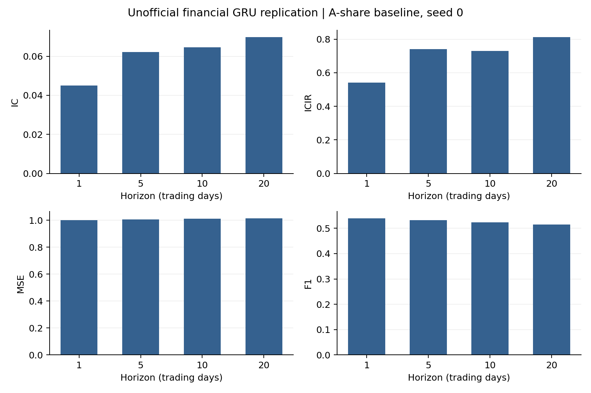

# GRU-Replication

**非官方、独立复现：本仓库不是GRU或FactorGCL论文作者的官方代码。**

[English](README.md) | [简体中文](README.zh-CN.md)

本仓库仅发布已完成的**金融GRU基线、seed=0**，使用A股日频数据（前复权），归档标识为`ashare_gru_seed0_20261007`。目标是复现**FactorGCL附录描述的股票收益预测GRU基线**，不涉及原始GRU论文的机器翻译训练或BLEU实验。本仓库没有seed42实验结果。

## 原论文与署名

**GRU原始论文**：*Learning Phrase Representations using RNN Encoder–Decoder for Statistical Machine Translation*，EMNLP 2014，1724–1734页。  
作者：**Kyunghyun Cho、Bart van Merriënboer、Caglar Gulcehre、Dzmitry Bahdanau、Fethi Bougares、Holger Schwenk、Yoshua Bengio**。

- [ACL Anthology官方页面](https://aclanthology.org/D14-1179/) · [DOI](https://doi.org/10.3115/v1/D14-1179) · [arXiv](https://arxiv.org/abs/1406.1078)
- [paper.pdf](paper.pdf)：本地保存的arXiv v3作者版本，15页，已包含附录。

**金融基线来源**：*FactorGCL: A Hypergraph-Based Factor Model with Temporal Residual Contrastive Learning for Stock Returns Prediction*，作者 **Yitong Duan、Weiran Wang、Jian Li**，清华大学，AAAI 2025，**39(1)，173–181页**。

- [论文官方页面](https://ojs.aaai.org/index.php/AAAI/article/view/31993) · [DOI](https://doi.org/10.1609/aaai.v39i1.31993)
- [FactorGCL原论文](references/FactorGCL-paper.pdf) · [FactorGCL附录](references/FactorGCL-appendix.pdf)

研究方法归功于原作者；本独立实现由[adrianelo0107](https://github.com/adrianelo0107)维护，与论文作者、所在机构、ACL及AAAI不存在隶属或背书关系。未上传其他非官方实现目录。

## 实际实验与结果

模型为PyTorch标准**两层32维单向GRU，最后一层末态接共享四输出线性头**；每只股票、每个窗口零初态，bias开启、dropout为0，**没有BN、因子、行业图、投影头、CL或未来特征分支**。共**10,308个可训练参数**，损失仅为有效股票/期限标签元素的masked MSE。

测试区间为2020年1月至2023年6月，共**846个信号日、42个月、3,384个日期/期限键**。原全图预测14,620,736行，包含逐股票实际标签与收益，未上传。

| 预测期限（交易日） | IC | ICIR | MSE | F1 |
|---|---:|---:|---:|---:|
| 1 | 0.045087 | 0.540233 | 1.000630 | 0.539254 |
| 5 | 0.062201 | 0.739637 | 1.005623 | 0.531890 |
| 10 | 0.064562 | 0.729079 | 1.011559 | 0.524230 |
| 20 | 0.069904 | 0.812965 | 1.013363 | 0.515359 |



[完整训练与验证曲线](results/ashare_gru_seed0/figures/training_history.png) · [42个月IC](results/ashare_gru_seed0/figures/monthly_ic.png)

IC为有效标签截面逐日Pearson相关系数均值；ICIR为日IC均值除以总体标准差（`ddof=0`），不年化。MSE为截面标准化标签上的逐日MSE等权均值，另保存pooled MSE。F1汇总预测与**标准化标签**的严格正负符号TP/FP/FN，不是对原始收益是否大于0分类；零符号另计。总样本外指标由两折日度记录拼接重算，不直接平均两折ICIR/F1。月度仅事后描述，单seed结果不能证明稳健性或与FactorGCL的稳定排序。

## 训练协议与补全设定

| 折 | 训练 | 验证 | 测试 | 最佳轮 | 停止轮 | 最佳四期限验证平均IC |
|---|---|---|---|---:|---:|---:|
| 1 | 2014–2018 | 2019 | 2020–2021 | 37 | 57 | 0.084779673 |
| 2 | 2016–2020 | 2021 | 2022年1月–2023年6月 | 31 | 51 | 0.057788898 |

- 每折seed **0**从头初始化，独立拟合训练scaler，不复用其他实验权重或已拟合scaler。
- 输入为60个市场交易日、六列`high,open,low,close,vwap,volume`。价格除以窗口末日收盘价，成交量除以窗口内有效均量。
- 历史缺失容忍20%；归一化、训练裁剪后填0；无效标签mask。训练段0.1%/99.9%分位裁剪，每特征最多200,000个seed控制的priority-reservoir样本。
- 原始收益为`VWAP[t+h+1] / VWAP[t+1] − 1`，期限1/5/10/20，再在有效股票截面上标准化（`ddof=0`）。原始收益与标准化标签均不裁剪。
- 每日完整截面一步，日期洗牌；Adam学习率0.001、betas0.9/0.999、eps1e-8、weight decay0。训练与验证尾部按21交易日前视跨度purge，标签端点留在各自分区。
- 最多100轮，每轮验证，四期限验证IC算术平均严格改善才更新best（`min_delta=0`），连续20轮未改善则停，用best测试。FactorGCL附录只明确“early stopping set to 20 steps”，监控指标及按epoch解释属于复现补全。

**结构补全。** FactorGCL金融基线仅描述GRU接线性预测层；两层32维、不加BN、共享四期限头、初始化等未披露细节均为明确标注的实现选择，不能当作作者已完整披露的参数。PyTorch采用**reset-after**候选状态公式，而原GRU论文的编码器公式为reset-before；本实现不声称逐公式完全复现原编码器。提供独立门控展开并与PyTorch核对。

**数据与预处理。** 使用A股日频数据（前复权）。输入区间2013-10-10至2023-07-31，正式信号区间2014-01-01至2023-06-30，测试区间2020-01-01至2023-06-30。同股同日四个调整前后OHLC，在四位小数共同舍入区间（半单位`0.00005`）内做无截距约束最小二乘，计算`估计乘数 × 新成交额 / 旧未复权成交量`。要求新旧成交额一致，原成交量仍作为量特征保留。重建值同时进入特征和收益标签，是估计值而非供应商精确复权因子；不夹到高低价内，工具沿用历史`0.011`容差拒绝显著越界。

未使用后来增加的ST、停复牌或交易状态筛选，也没有持有路径可交易性筛选；端点价格有效且为正即参与标签资格判断。前复权基准日未知，静态行业并非完整时点可得。共享加载器仍用**134行业的资格映射**保留原样本，但GRU不使用行业图暴露作为输入；FactorGCL原论文为83行业。数据、样本与实现补全差异限制与论文的直接数值比较，不能视为可投资回测。

## 仓库内容

```text
paper.pdf                        GRU作者版本，包含附录
references/                      FactorGCL原论文与附录
README.md / README.zh-CN.md       中英说明
CITATION.cff / NOTICE / LICENSE   引用、署名和许可范围
requirements.txt                 原运行依赖版本
code/configs/ashare_gru_seed0.json    可移植seed0配置
code/factorgcl/                   共享数值引擎与FinancialGRU
code/protocol.py / code/train.py  独立金融基线协议与运行入口
code/reconstruct_vwap.py          私有同键OHLC输入的重建工具
code/verify_results.py            无需行情的文件/指标/轮次/模型核验
code/smoke_test.py                临时合成数据CPU训练/恢复/门控检查
code/plot_results.py              仅绘制本次GRU结果
results/ashare_gru_seed0/             实际汇总结果、scaler和best模型tensor
SHA256SUMS.json                   发布文件SHA-256清单
```

保留总/分折日度指标、四期限指标、42月汇总、完整训练与验证逐轮记录、验证预测校准摘要、scaler、图和来源。验证预测均值/标准差/正类比例基于标签mask前全部历史可预测节点，验证F1基于有效标签，两者观察范围不同。

`model_state.pt`从原best提取，**仅含模型tensor**，支持`torch.load(..., weights_only=True)`；不含优化器、RNG或完整配置，不能恢复原历史训练。推理仍需匹配scaler及预处理/样本构造。

共享训练/数据/评估/损失源码与原执行版本SHA-256一致并保留；模型、工厂及参考门控定义不变，仅移除父项目路径引导。独立入口、导入、路径和协议检查作适配，只读验证诊断保留。公开路径和协议标识使用统一名称，保存的原实验签名标识历史运行，新训练生成自己的checkpoint签名。见[provenance.json](results/ashare_gru_seed0/provenance.json)。新克隆能核验仓库产物，不能凭输入指纹独立恢复未公开行情或逐股票预测。

## 安装与无数据核验

原环境：Python3.11.5、PyTorch2.2.2+cu121、NumPy1.26.4、pandas2.2.3、CUDA12.1、RTX4090。锁定依赖请使用**Python3.10或3.11**。这不是完整环境锁，不保证跨版本、跨硬件GPU逐bit一致。

在仓库根目录创建并按操作系统激活虚拟环境，然后运行：

```bash
python -m venv .venv
python -m pip install -r requirements.txt
python -B code/verify_results.py
python -B code/smoke_test.py
python -B code/plot_results.py --output-dir outputs/figures
```

安装前请激活环境。CUDA可先安装官方对应wheel，例如`python -m pip install torch==2.2.2 --index-url https://download.pytorch.org/whl/cu121`。归档核验无需行情；烟测用临时合成数据检查门控公式及连续/恢复训练的模型、Adam、scaler、RNG、验证和预测一致性，不代表重新完成金融实验。

## 自备输入并训练

**不提供任何数据**：行情、日历、行业映射/字典、缓存、逐股票实际标签/收益均不上传，也不附带下载凭据。请在被Git忽略的`data/`内自行准备：

| 文件 | 必需字段/约定 |
|---|---|
| `panel.csv` | `order_book_id,date,high,open,low,close,vwap,volume`；股票/日期唯一且排序；六特征有限且为正；如`600000.XSHG`、`000001.XSHE` |
| `trading_calendar.csv` | `date,is_sample_period`；递增且无重复市场日历，含热身和尾部；ISO日期与布尔标记 |
| `stock_industry_sw2021.csv` | `stock_code,sw2021_l2_id`；六位股票代码为字符串，每股一条静态行业记录 |
| `sw2021_l2_mapping.csv` | `sw2021_l2_id`；完整`0..133` |

历史输入2013-10-10至2023-07-31，在正式2014-01-01至2023-06-30信号区间前后保留59日热身、21日尾部。主表8,207,297行，行业匹配后8,134,074条观测，缓存`2390 × 4898 × 6`，其中4,897只股票至少出现一次。新快照可能不同；只公开输入指纹，不公开内容。

训练器读取已清理好的格式；可选重建工具要求调整前后CSV主键完全一致且排序，并有OHLC、`volume`、`total_turnover`：

```bash
python -B code/reconstruct_vwap.py --adjusted data/adjusted_clean.csv --unadjusted data/unadjusted_clean.csv --output data/panel.csv
python -B code/train.py --prepare-only
python -B code/train.py
python -B code/train.py --fold fold_1 --resume
```

两折串行输出到新的`outputs/ashare_gru_seed0/`，禁止训练覆盖发布的`results/`。可加`--device cpu`或`--device auto`。恢复需该次新运行自己的完整`last.pt`，包含优化器/scaler/RNG；不能用发布的纯权重代替。缓存签名含输入元数据，移动或重新生成输入后可能需另建缓存。

## 引用与许可

请同时引用[Cho等（2014）](https://doi.org/10.3115/v1/D14-1179)的GRU来源和[Duan等（2025）](https://doi.org/10.1609/aaai.v39i1.31993)的金融基线来源，使用实现时注明本仓库。[CITATION.cff](CITATION.cff)提供机器可读引用。

独立代码和仓库说明采用MIT许可；原论文/附录保留作者及出版方权利，**不适用MIT许可**，也不授予第三方行情或行业数据使用权。见[LICENSE](LICENSE)与[NOTICE](NOTICE)。
